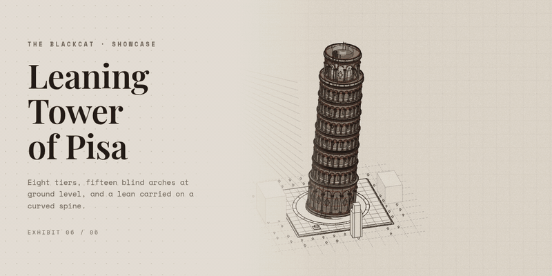
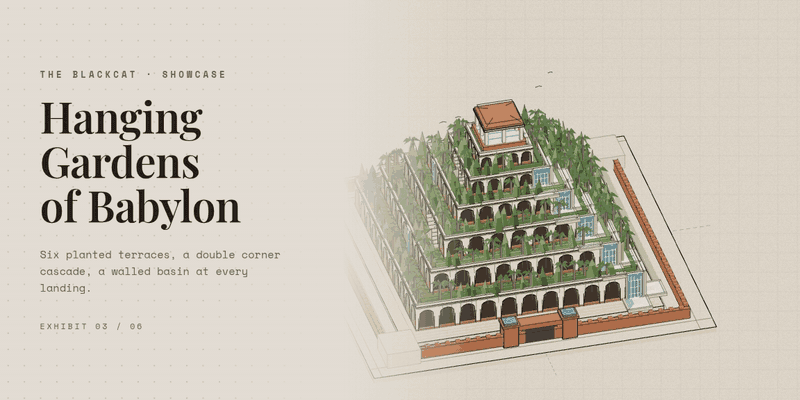

# Axonometric Plates

Architectural drawings that run in the browser. Each plate is a single HTML file: a building drawn as an axonometric on drafting paper — flat ink-and-wash surfaces, one light direction, the structure opened up rather than hidden — built procedurally in Three.js and free to orbit.

Drag to orbit, scroll to zoom, double-click to reset the view.

## The plates

| Plate | Seed |
| --- | --- |
| [Christ the Redeemer](plates/christ-the-redeemer.html) | 1931 |
| [Colosseum](plates/colosseum.html) | 80 |
| [Hanging Gardens of Babylon](plates/hanging-gardens.html) | 601 |
| [Hanging Gardens, earlier reconstruction](plates/hanging-gardens-reconstruction.html) | 604 |
| [Hoogbouw](plates/hoogbouw.html) | 3727 |
| [Petra — Al-Khazneh (The Treasury)](plates/petra.html) | 312 |
| [Leaning Tower of Pisa](plates/pisa.html) | 1173 |

The seed is the `mulberry32` PRNG seed baked into each file: a year that matters to the subject (1931 the statue was dedicated, AD 80 the Colosseum, 1173 the first stone of Pisa).

## How a plate is built

Every plate follows the same contract, which is what makes them a series rather than seven one-offs:

- **One file, no assets.** A single HTML page; the whole building is generated by JavaScript at load. No model files, no textures, no build step.
- **True axonometric camera.** An orthographic camera on the (1, ~0.78, 1) diagonal, with damped orbit controls — the drawing is a projection, never a perspective render.
- **Wash + ink.** Surfaces are flat vertex-coloured triangles shaded from a five-step palette per material (`lit / mid / shade / top / bot`) by a single light direction. Over them, the linework is drawn as line segments in six ink weights — bold, medium, fine, and rust / teal / faint accents — so the drawing keeps its hierarchy from any angle.
- **Drafting paper.** A 2D canvas overlay lays a faint orthogonal grid and per-pixel grain over the render in multiply blend; the page background never changes colour.
- **Deterministic hand.** All jitter — the slight overshoot and wobble that keeps the ink from looking machined — comes from the seeded PRNG, so a plate renders identically on every load.
- **Survey furniture.** Each subject sits on a plinth in a dashed site grid, with sketched shrubs, ghost context masses at the edges, and faint construction geometry (rays, proportion circles, plumb lines) left on the sheet.
- **Dependencies.** Five plates load Three.js r128 and OrbitControls from CDN. `colosseum.html` and `hanging-gardens.html` carry the library inline and run fully offline.

## Viewing

Open any file in `plates/` in a browser. That's it — no server, no build step.

## Published

All seven plates are also published, with write-ups, in the Showcase on The BlackCat:

- [Christ the Redeemer](https://theblackcat98.github.io/TheBlackCat/showcase/christ-the-redeemer/)
- [Colosseum](https://theblackcat98.github.io/TheBlackCat/showcase/colosseum/)
- [Hanging Gardens of Babylon](https://theblackcat98.github.io/TheBlackCat/showcase/hanging-gardens/)
- [Hanging Gardens, earlier reconstruction](https://theblackcat98.github.io/TheBlackCat/showcase/hanging-gardens-reconstruction/)
- [Hoogbouw](https://theblackcat98.github.io/TheBlackCat/showcase/hoogbouw/)
- [Petra — Al-Khazneh (The Treasury)](https://theblackcat98.github.io/TheBlackCat/showcase/petra/)
- [Leaning Tower of Pisa](https://theblackcat98.github.io/TheBlackCat/showcase/pisa/)

The `banner-*.gif` files in `assets/` are the animated banners made for those showcase exhibits; a few of them illustrate this README.

## The skill

This repository is also the home of the skill used to write these plates: **[SKILL.md](SKILL.md)** — the style contract, the builder catalog, the workflow, and the verification pass, written down so a new plate can be commissioned the same way these were. It ships with **[template.html](plates/template.html)**, the canonical engine with a small demo rotunda: copy it, set the seed, replace the demo subject.
